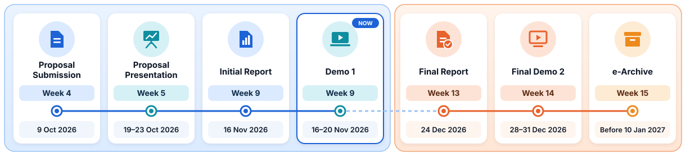

# VanQ – Van Rental, Simplified

**VanQ: Van Rental Management App for Tourists**, a Software Engineering Laboratory (**TMA3084**)
project by **G01_T13 (Team MLM)**, Universiti Malaysia Sarawak, Semester 1 2026/2027.

VanQ replaces Van Sewa Samariang's manual WhatsApp booking process. Tourists book a van
(self-drive or with a driver), the owner verifies documents and deposits and assigns vans and
drivers, and drivers manage their trips and see their earnings. The app has three roles:
**Customer**, **Driver** and **Admin (owner)**. It is built with Flutter, with a Supabase backend planned.

> Current state: a clickable Flutter prototype of all 21 Figma screens, using sample data with no
> backend yet.

| | |
|---|---|
| Client | Saie Bin Kip, CEO, Van Sewa Samariang |
| Lecturer | Mdm. Nurfauza Jali |
| Lab group / Demonstrator | Group 1 / Mr. Aminul Islam Rakib |

## Team

| Name | GitHub | TSPi role | Owns |
|---|---|---|---|
| Romeo Ryan Munan Anak Roland | [@Moreoss-creator](https://github.com/Moreoss-creator) | Team Leader (Software Project Manager) | FR-21 |
| Muhammad Izzan Danish Bin Mohd Taufik | [@zannish05-code](https://github.com/zannish05-code) | Planning Manager (Lead Systems Analyst & Requirements Engineer) | FR-10, SRS |
| Muhammad Izzat Bin Patihie | [@izzatpatihie-dev](https://github.com/izzatpatihie-dev) | Development Manager (Lead Mobile Architect) | FR-01, FR-02, FR-03, Figma design |
| Vickson Ferrel Anak Raymond Lenggu | [@Vix0007](https://github.com/Vix0007) | Support Manager (Backend & AI Integration Specialist) | FR-20, FR-30, FR-AI-01, repository |
| Bryan Andrew Amil | [@yonandrew](https://github.com/yonandrew) | Quality/Process Manager (QA & CI/CD Engineer) | Tests and CI |

## Timeline

<p align="center">
  
</p>

### Team progress

| Date | Activity | Output |
|---|---|---|
| 16 Oct 2026 | **Client meeting 1** with Saie Bin Kip (CEO), WhatsApp video call | Requirements gathered; [minutes](process_forms/meeting_minutes/Meeting_01_2026-10-16_Client.docx) |
| 17 Oct 2026 | **Proposal submitted** | [Proposal v1.0](docs/Proposal/) |
| 19–23 Oct 2026 | **Proposal presentation** (Week 5) | [Slides](docs/Proposal/TMA3084_G01_T13_Proposal_Slides.pptx) |
| 7 Nov 2026 | **Client meeting 2** with Syahmi bin Saie (client's representative), WhatsApp video call | Figma UI and navigation reviewed; Flutter features agreed; [minutes](process_forms/meeting_minutes/Meeting_02_2026-11-07_Client.md) |
| 14 Nov 2026 | SRS tasks distributed | |
| 14–18 Nov 2026 | SRS first draft | |
| 16 Nov 2026 | **SRS accepted by the client** (Saie Bin Kip), signed | SRS §4.5 Client Acceptance of Requirements |
| 18 Nov 2026 | Slides and video tasks distributed | |
| 19 Nov 2026 | Figma design converted to the Flutter prototype; GitHub repository set up | [`src/`](src/) |
| 19–20 Nov 2026 | SRS and slides finalised; repository organised into `src/`, `docs/`, `process_forms/` | [`docs/SRS`](docs/SRS/), [`docs/Slides`](docs/Slides/) |

## Repository structure

```
.github/workflows/ci.yml   automatic analyze + test + web build on every push and pull request
docs/                      Proposal, SRS, SDS, STD and Slides (see docs/README.md)
process_forms/             LOGD (defects), LOGAI (AI-tool use) and meeting minutes
src/                       the Flutter app
```

## Design

- Figma design file: https://www.figma.com/design/TVs7lNQiVllSxmW1t3uWId/VanQ-Prototype-%E2%80%93-T13
- Figma clickable prototype: https://www.figma.com/proto/TVs7lNQiVllSxmW1t3uWId/VanQ-Prototype-%E2%80%93-T13?node-id=3-8&starting-point-node-id=3%3A8

## Run the app

You need the Flutter SDK (3.47.8 is what CI uses; 3.19 or newer should work).

```bash
cd src
flutter pub get
flutter run -d chrome     # or just `flutter run` for a phone/emulator
```

Run the checks that CI runs:

```bash
cd src
flutter analyze
flutter test
```

## Prototype walkthrough

**Login (UI-01)**: **Sign In** or **Customer** opens the customer app. **Driver** and **Admin** open those apps.

**Customer**
- Home (UI-02): tap an available van to open the Booking form (UI-03).
- Booking form: **Continue** is enabled once you tick the licence box (self-drive) or pick **With driver**, which adds the RM 150 driver fee.
- **Get AI place ideas** opens the AI suggestions sheet (UI-05). Every second time you open it, it shows the "fallback" state (error + Retry), so you can demo both designs.
- Upload + summary (UI-04): tap **Upload** on the rental form and **Submit booking** becomes enabled. That opens Booking submitted.
- My bookings (UI-06) and Profile use the bottom navigation.

**Driver**
- Trips (UI-07): **Start trip** switches the card to Ongoing. **End trip** asks for confirmation, then moves it to Completed.
- Earnings and Profile use the bottom navigation.

**Admin**
- Dashboard (UI-08): tap a booking to open Booking review (UI-11). Tap the **SB** avatar to open the admin profile.
- The **Bookings** tab opens Booking review for the first booking awaiting review, as in the Figma prototype.
- Booking review: verify the documents and tick **Deposit received** to enable **Confirm booking**. **Assign van & driver** opens UI-09.
- Income & salary (UI-10): the October tab uses sample numbers.

## Code structure (`src/`)

```
lib/
  main.dart                 app entry + navigation helpers
  theme/                    colours, Inter text styles, theme (from Figma variables)
  data/sample_data.dart     all sample content from the Figma screens
  widgets/                  Figma components: Button, Text Field, Chip, Status Badge,
                            Info Row, Booking/Van/Trip cards, glass bottom nav, etc.
  screens/auth/             UI-01 Login
  screens/customer/         UI-02 to UI-06 + Booking submitted
  screens/driver/           UI-07 Trip schedule, Earnings
  screens/admin/            UI-08 to UI-11
  screens/shared/           Profile (Customer / Driver / Admin)
assets/images/              Figma logo and van photos
assets/icons/               Figma SVG icons (bottom nav, back, checkbox, chevron, calendar, pin)
test/widget_test.dart       login + role navigation tests
```

## Notes

- Fonts: Inter is loaded with `google_fonts`, so the first launch needs internet.
- A few small icons (van, person, document, upload, info) are Material icons, not Figma ones.
- File upload is simulated. For real uploads, add `file_picker` or `image_picker` in `upload_summary_screen.dart`.
- Top spacing follows Figma (56px, 96px on Login and Booking submitted) in a browser; on a phone the
  status-bar height is added on top.
